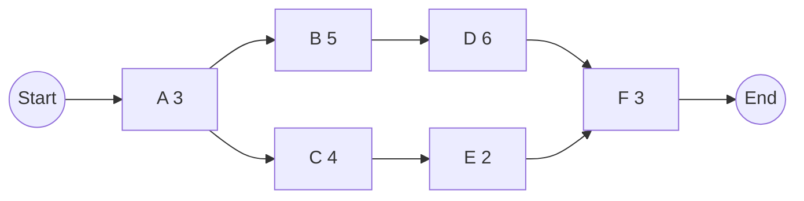

# INFO6007 情景题库（Scenario-Based Question Bank）逐题解析

> - **课程**：INFO6007 — Project Management in IT
> - **材料**：`Exam Prep/Project Management Scenario-Based Question Bank.pdf`（9 页，28 题）
> - **⚠️ 答案来源**：题库开头写明老师**不会发布答案**，下面**全部是自拟、非官方**的答题要点。计算题（Q6.1、Q16、Q18、Q22、Q23、Q25、Q28）结果是确定的；论述题给的是「得分点框架」，考试时要结合情景展开成段落。与各周笔记中「📝 考试相关」的提示方向一致。
> - **定位**：每道题都把两三个主题揉在一起，题型和 [[26-S2-Course/INFO6007/INFO6007-Practice-Exam-S2-2026-Solutions|Practice Exam]] 一致。正式考试 4 道题，这 28 道题基本覆盖了所有可能的组合。

## 题目 → 周次速查

| 题 | 主题 | 周次 |
|:---:|:---|:---|
| 1–5 | 项目 vs 运营、三重约束、成功标准、生命周期、阶段关口 | W01、W02、W09、W10 |
| 6 | 质量 + 采购 + 风险（博物馆数字档案） | W05、W07、W08、W09 |
| 7–8 | 方法论选型、Scrum/Kanban/Waterfall、混合 | W02 |
| 9–13 | 需求、可追溯性、非功能需求、验收、范围确认 | W03、W05 |
| 14–15 | WBS | W03 |
| 16–19 | 网络图、关键路径、依赖、赶工、快速跟进 | W03 |
| 20–21 | 资源平衡、RACI、冲突处理 | W06 |
| 22–23 | EVM | W04 |
| 24 | 质量保证 / 控制、质量成本、质量工具 | W05 |
| 25 | EMV、应急储备 | W07 |
| 26–28 | ITSM：服务关系、四维度、指导原则、SVS、SLM | W11、W12 |

---

## 一、项目基础与生命周期（Q1–Q5）

### Q1 远程医疗预约系统「永远做不完」

> **Original question (English)** · Question 1. A hospital launches a telehealth booking system. Six months after go-live, the same team continues to add features each week, answer user queries and fix minor bugs. The sponsor says, "The telehealth project is never finished." Meanwhile, the finance director wants to know whether the original investment succeeded.
>
> 1. Decide which of the ongoing activities are project work and which are operations, and justify your answer.
> 2. Explain how scope creep and the absence of closure criteria contributed to this situation.
> 3. Recommend how success criteria and closure should have been defined at initiation.

1. **项目 vs 运营**：项目是**临时的、有明确起止和独特成果**；运营是**持续的、重复的**。每周加的新功能 → 项目工作（应作为新项目/新版本立项）；回答用户问题、修小 bug → **运营**（应移交给 IT 服务管理/服务台）。
2. **原因**：没有收尾标准，项目无法正式结束；功能不断追加而没有评估和审批 = **范围蔓延**；同一团队既做项目又做运营，成本无法归集，财务总监自然无法判断原投资是否成功。
3. **启动时就该做**：在**项目章程**中写明可衡量的成功标准（如预约完成率、上线 6 个月内 X% 门诊使用、减少 Y% 电话预约）和**收尾条件**（交付哪些功能、验收标准）；上线后**正式移交运营**、做收尾和经验教训；后续增强走新的立项/变更流程；定期做**收益实现评审**回答财务总监的问题。

**知识点**：[[26-S2-Course/INFO6007/INFO6007-Week01-Introduction-Summary|W01 项目定义]]、[[26-S2-Course/INFO6007/INFO6007-Week10-Integration-Management-Summary|W10 项目收尾]]

**English answer (Unofficial, self-drafted) — model answer**

1. A project is temporary, with a defined start, end and unique outcome; operations are ongoing and repetitive. Adding new features every week is **project work** (it should be scoped as a new release or project). Answering user queries and fixing minor bugs are **operations** and should be handed over to IT service management / the service desk.
2. Without closure criteria the project could never formally end. Features kept being added without assessment or approval (**scope creep**), and the same team mixed project and operational work, so costs could not be attributed – which is why the finance director cannot judge whether the original investment succeeded.
3. The **project charter** should have defined measurable success criteria (e.g. booking completion rate, X% of clinics using the system within 6 months, Y% fewer phone bookings) and **closure criteria** (which features, which acceptance criteria). At go-live the system should be formally handed over to operations, with project closure and lessons learned; later enhancements go through new initiation / change control, and a **benefits-realisation review** answers the finance director.

### Q2 固定预算 + 法定截止日期 + 新增 30% 工作量

> **Original question (English)** · Question 2. A project to build a regulatory reporting tool has a fixed budget and an immovable legal deadline. Midway through, the client requests an additional analytics module. The team estimates it needs 30% more effort. The sponsor insists nothing else can change.
>
> 1. Explain the impact of the request on scope, time, cost and quality.
> 2. Identify three realistic options for the project manager and the trade-offs of each.
> 3. Recommend a course of action, and state which constraint should be treated as flexible and why.

1. **影响**：范围 +30%；在时间、成本都固定的情况下，只能靠压缩质量（少测试、加班出错）来吸收 → **质量风险最大**；或者干脆做不完。
2. **三个选项与权衡**：
   - **拒绝 / 推迟到下一阶段**：保住截止和预算，但客户不满；
   - **增加资源或预算**：需要赞助人追加经费，新人上手慢（Brooks 定律）；
   - **用 MoSCoW 做范围交换**：只做分析模块的核心部分，或删掉其他低优先级功能腾出空间；客户需要接受取舍。
3. **推荐**：法定截止日期**不能动**，预算被固定，因此**范围是唯一可以灵活的约束**——通过正式变更控制评估影响，与客户用 MoSCoW 排优先级，把分析模块放进上线后的第二阶段。向赞助人说明「什么都不变」在物理上做不到，会以质量为代价。

**知识点**：[[26-S2-Course/INFO6007/INFO6007-Week02-Tutorial-Triple-Constraint|W02 Tutorial 三重约束]]

**English answer (Unofficial, self-drafted) — model answer**

1. Scope grows by 30% while time and cost are fixed, so the only thing left to absorb the work is **quality** (less testing, overtime errors) – or the work simply will not be finished. Quality is the biggest risk.
2. Options: **(a) decline or defer** the module to a later phase – keeps deadline and budget, but the client is unhappy; **(b) add resources or budget** – needs sponsor funding, and new people take time to ramp up (Brooks' law); **(c) trade scope using MoSCoW** – deliver only the core of the analytics module or drop lower-priority features to make room, which the client must accept.
3. The legal deadline cannot move and the budget is fixed, so **scope is the only flexible constraint**. Assess the request through formal change control, prioritise with the client using MoSCoW, and schedule the analytics module as a phase-two release after go-live. Explain to the sponsor that "nothing else changes" is not achievable without sacrificing quality.

### Q3 项目 A 按时按预算但采用率 20%；项目 B 超支延期但处理时间减半

> **Original question (English)** · Question 3. Project A finished on time and on budget with all specified features, but only 20% of intended users adopted the system. Project B overran its budget by 20% and finished a month late, yet it cut customer processing time by half and the sponsor calls it a success.
>
> 1. Evaluate each project against the triple constraint.
> 2. Evaluate each project against broader measures of success such as benefits realisation and stakeholder satisfaction.
> 3. Recommend how success criteria should be set at initiation and who should agree them.

1. **三重约束**：A 完全达标；B 超支 20%、延期一个月，不达标。
2. **更广的成功衡量**：A 的**收益没有实现**（采用率低 → 投资回报低、干系人不满意），是「产出成功、成果失败」；B 实现了核心业务收益（处理时间减半），赞助人满意，是「产出不完美、成果成功」。三重约束是**产出视角**，收益实现和干系人满意度是**成果视角**。
3. **启动时设定成功标准**：在商业论证和章程中写明**可衡量的业务成果**（采用率、处理时间、成本节约）以及时间/成本容差；由**赞助人与关键干系人（业务负责人、用户代表）共同确认**，PM 协助；并约定收益由谁负责、何时评审。

**知识点**：[[26-S2-Course/INFO6007/INFO6007-Week01-Introduction-Summary|W01 项目成功]]、[[26-S2-Course/INFO6007/INFO6007-Week12-ITSM-Processes-2-Summary|W12 价值与成果]]

**English answer (Unofficial, self-drafted) — model answer**

1. **Triple constraint:** A fully meets scope, time and cost; B fails on cost (+20%) and time (one month late).
2. **Broader success:** A's **benefits were not realised** – 20% adoption means low return on investment and dissatisfied stakeholders ("output success, outcome failure"). B delivered its core business benefit (processing time halved) and the sponsor is satisfied ("imperfect output, successful outcome"). The triple constraint measures outputs; benefits realisation and stakeholder satisfaction measure outcomes.
3. At initiation, the business case and charter should state **measurable business outcomes** (adoption rate, processing time, cost savings) plus tolerances for time and cost. These should be **agreed by the sponsor and key stakeholders** (business owners, user representatives), facilitated by the PM, together with who owns the benefits and when they will be reviewed.

### Q4 章程没批就开始做原型

> **Original question (English)** · Question 4. An enthusiastic project manager begins building prototypes in the first week, before a charter has been approved, because "the client is eager to see progress." Three weeks later the sponsor questions the budget, and two stakeholders discover they were never consulted.
>
> 1. Identify which life cycle phase was skipped and the key outputs that should have been produced.
> 2. Explain the consequences of this decision for scope, risk and stakeholder engagement.
> 3. Describe what the project manager should do now to recover the situation.

1. **跳过的阶段**：**启动（Initiation）**。应产出：**项目章程**（目标、范围概要、预算、赞助人授权）、**干系人登记册**、初步范围说明 / 商业论证。
2. **后果**：范围没有边界 → 原型可能做错方向，造成返工；风险未识别，预算没有授权（赞助人现在质疑预算）；干系人未被识别和咨询 → 需求缺失、抵触，后期变更代价更高。
3. **补救**：**暂停扩展性工作**；补做章程并获赞助人批准；补做干系人识别与分析，与被遗漏的两位干系人沟通并收集需求；把原型作为**需求澄清工具**而不是交付物；按批准的范围重新规划。

**知识点**：[[26-S2-Course/INFO6007/INFO6007-Week10-Integration-Management-Summary|W10 制定项目章程]]、[[26-S2-Course/INFO6007/INFO6007-Week03-Tutorial-Methodology-Stakeholder|W03 Tutorial 干系人分析]]

**English answer (Unofficial, self-drafted) — model answer**

1. The **initiation** phase was skipped. Its key outputs are the **project charter** (objectives, high-level scope, budget, sponsor authorisation), the **stakeholder register** and a preliminary scope statement / business case.
2. **Scope:** no agreed boundary, so the prototypes may go in the wrong direction and cause rework. **Risk:** risks were never identified and the budget was never authorised – hence the sponsor's questions. **Stakeholders:** two stakeholders were not identified or consulted, so requirements are missing, resistance is likely and later changes will cost more.
3. **Pause further build work**; prepare the charter and get sponsor approval; carry out stakeholder identification and analysis, meet the two missed stakeholders and collect their requirements; treat the prototypes as a requirements-clarification tool rather than deliverables; re-plan against the approved scope.

### Q5 阶段关口：成本超预算 25% + 关键供应商退出

> **Original question (English)** · Question 5. At the end of the design phase, a phase-gate review finds that estimated costs are 25% above the approved budget and a key supplier has withdrawn. The team argues that stopping now would waste the work already completed and wants to proceed to build.
>
> 1. Evaluate the argument about wasted work, using the idea of sunk cost.
> 2. If the committee terminates the project, outline the closing activities that must still be completed and the value of lessons learned.

1. **沉没成本**：已经花掉的钱无论继续还是终止都收不回来，**不应影响决策**。决策只看**剩余成本 vs 剩余收益**和风险：成本超 25%、供应商退出都显著提高了剩余成本和风险，「不想浪费」是沉没成本谬误。阶段关口存在的意义就是在这时做「继续 / 调整 / 终止」的决策。
2. **终止后仍要做的收尾**：正式终止并通知干系人；结清合同（与供应商的终止条款、付款）；释放资源和人员；**归档文档**（设计成果可能将来复用）；财务结算；**经验教训**——例如估算为什么偏差 25%、供应商风险为什么没提前识别。经验教训能改进组织的估算和供应商评估，避免下个项目重犯。

**知识点**：[[26-S2-Course/INFO6007/INFO6007-Week09-Leadership-Governance-Alignment-Summary|W09 治理与阶段关口]]、[[26-S2-Course/INFO6007/INFO6007-Week10-Integration-Management-Summary|W10 收尾]]

**English answer (Unofficial, self-drafted) — model answer**

1. Money already spent is a **sunk cost**: it is lost whether the project continues or stops, so it should not drive the decision. The decision should compare **remaining cost against remaining benefit and risk**. A 25% cost overrun and the loss of a key supplier both raise the remaining cost and risk, so "not wanting to waste work" is the sunk-cost fallacy. The phase gate exists precisely to decide go / adjust / stop at this point.
2. **Closing activities:** formally terminate and notify stakeholders; close contracts (supplier termination terms, final payments); release staff and resources; **archive documentation** (the design may be reused); complete financial closure; capture **lessons learned** – e.g. why the estimate was 25% off and why supplier risk was not identified earlier. Lessons learned improve the organisation's future estimating and supplier evaluation so the same mistakes are not repeated.

---

## 二、综合情景：博物馆数字档案（Q6）

### Q6.1 质量检查

> **Original question (English)** · Question 6. A regional museum is developing an online digital archive that will allow the public to search and explore its collection of historical photographs. The project involves scanning photographs, creating catalogue information, developing a searchable website, and ensuring that appropriate permissions are obtained before images are made publicly available. The museum has contracted an external supplier to digitise the photographs, while museum staff are responsible for reviewing the materials and preparing them for publication.
>
> 1. The supplier submits a batch of 1,750 digitised photographs. Quality checks identify 105 photographs that fail the agreed image-resolution and readability requirements. The contract specifies that at least 97% of each batch must pass quality checks before acceptance.
> a. Calculate the percentage of photographs that passed the quality checks and determine whether the batch meets the acceptance requirement.
> b. Recommend one quality assurance activity and one quality control activity that could help address the problem. Explain the purpose of each.

$$
\text{合格率} = \frac{1750 - 105}{1750} = \frac{1645}{1750} = 94\%
$$

**94% < 97% → 不满足验收要求**，整批不应接收。

- **质量保证（QA，预防）**：在合同/SOW 中细化分辨率和可读性标准，并对供应商的扫描流程做**审计**、先做小批量试扫确认流程 → 从源头防止缺陷；
- **质量控制（QC，检测）**：对每批进行**抽样检查**（或全检），按标准判定合格/不合格并记录缺陷类型（可用 Pareto 图找主要原因）→ 发现并拦截不合格品。

**知识点**：[[26-S2-Course/INFO6007/INFO6007-Week05-Quality-Management-Summary|W05 质量保证与质量控制]]

**English answer (Unofficial, self-drafted) — model answer**

a. Pass rate = (1,750 − 105) / 1,750 = 1,645 / 1,750 = **94%**. 94% < 97%, so the batch **does not meet** the acceptance requirement and should not be accepted.\
b. **QA (prevention, process):** specify the resolution and readability standards precisely in the contract/SOW, audit the supplier's scanning process and run a small pilot batch before full production, so defects are prevented at the source. **QC (detection, product):** inspect every batch (sampling or full inspection) against the standard, record pass/fail and defect types (a Pareto chart shows the main causes), so non-conforming scans are caught before acceptance.

### Q6.2 供应商要求全额付款并对返工另收费

> **Original question (English)** · 2. The supplier argues that it has completed the agreed number of scans and requests payment for the entire batch. Museum staff disagree because some photographs do not meet the contractual quality requirements. The supplier also claims that correcting the rejected photographs will require additional payment. Explain how the project manager should address this disagreement using procurement management practices. Recommend two specific actions the project manager should take and explain how each would help protect the museum's interests while maintaining an effective supplier relationship.

依据**合同和 SOW 中的验收标准**处理：供应商交付的是「合格的扫描件」，而不只是「扫描数量」。

1. **书面通知不合格并按合同付款**：引用 97% 的验收条款和 QC 记录，暂不支付整批款项（或只按合同允许支付合格部分）——先验收后付款，保护博物馆的资金；
2. **要求免费返工并提交纠正计划**：不达标的返工属于履约义务，**不是范围变更，不应额外付费**；约定返工期限，后续批次加强检查。

**维持关系**：基于事实和合同沟通，定期绩效评审，记录一切往来；争议不决时按合同的**升级 / 争议解决条款**处理，而不是直接终止。

**知识点**：[[26-S2-Course/INFO6007/INFO6007-Week08-Procurement-Management-Summary|W08 控制采购与合同管理]]

**English answer (Unofficial, self-drafted) — model answer**

Handle it under **Control Procurements**, using the acceptance criteria in the contract and SOW: the supplier must deliver conforming scans, not simply a number of scans.

1. **Issue a formal written notice of non-conformance and pay according to the contract** – cite the 97% acceptance clause and the QC records, and withhold payment for the batch (or pay only what the contract allows for conforming items). Accepting before paying protects the museum's money.
2. **Require free rework and a corrective-action plan** – fixing non-conforming work is part of the supplier's contractual obligation, not a scope change, so it should not cost extra; agree a rework deadline and tighter checks on later batches.
To keep the relationship effective, communicate on facts and contract terms, hold regular performance reviews, document all correspondence, and use the contract's escalation / dispute-resolution clause if needed rather than terminating straight away.

### Q6.3 赞助人要立刻全部公开，策展人主张暂缓敏感照片

> **Original question (English)** · 3. As the archive approaches publication, museum staff discover that some photographs may contain sensitive information or have unresolved permissions for public use. The project sponsor wants the entire collection published immediately to attract visitors, while the curators recommend withholding the affected photographs until the concerns are resolved. Evaluate the sponsor's proposal by considering the museum's risk appetite and the potential consequences of publication. Recommend an appropriate risk response and explain how project governance and stakeholder engagement should support the final decision.

- **评价**：博物馆是公共文化机构，**风险偏好通常偏保守（风险规避）**。公开含敏感信息或权限未解决的照片可能带来**法律责任（版权/隐私）、声誉损失、伤害相关社区**，这些影响远大于「多吸引游客」的短期收益，而且公开后难以撤回。
- **风险应对**：对受影响照片采取 **Avoid（暂不公开）**，先发布已确认权限的部分（分批发布），同时启动权限核查。
- **治理与干系人**：由治理层（赞助人 + 策展人 + 法务/合规）按决策权限做最终决定并记录；与权利人、相关社区沟通；向赞助人说明分批发布仍能实现吸引游客的目标。

**知识点**：[[26-S2-Course/INFO6007/INFO6007-Week07-Risk-Management-Summary|W07 风险偏好与应对]]、[[26-S2-Course/INFO6007/INFO6007-Week09-Leadership-Governance-Alignment-Summary|W09 治理]]

**English answer (Unofficial, self-drafted) — model answer**

- **Evaluation:** a public cultural institution usually has a **low (risk-averse) risk appetite**. Publishing photographs with sensitive content or unresolved permissions risks legal liability (copyright, privacy), reputational damage and harm to affected communities. These consequences outweigh the short-term gain in visitors, and published images are hard to withdraw, so the sponsor's proposal is not acceptable as it stands.
- **Risk response: avoid** for the affected photographs – withhold them, and publish the cleared portion now (phased release) while permissions are checked.
- **Governance and stakeholders:** the decision should be made by the appropriate governance body (sponsor, curators, legal/compliance) according to decision rights, and recorded. Engage rights holders and affected communities, and show the sponsor that a phased launch still achieves the goal of attracting visitors.

---

## 三、方法论（Q7–Q8）

### Q7 政府执照系统 vs 创业公司消费 App

> **Original question (English)** · Question 7. A government agency is building a licensing system under fixed legislation, a fixed-price contract and an audit requirement for full documentation. At the same time, a start-up is developing a consumer mobile app whose features will depend on early user feedback.
>
> 1. Recommend a methodology (Waterfall, Agile or Hybrid) for each project and justify it.
> 2. Compare how each approach handles change, documentation and customer involvement.
> 3. Identify one risk of applying your chosen approach to each project and suggest a mitigation.

1. **推荐**：政府系统 → **Waterfall**（法规固定、固定总价合同、审计要求完整文档）；创业 App → **Agile**（功能依赖早期用户反馈，需要快速迭代验证）。
2. **对比**：

| | Waterfall（政府） | Agile（创业） |
|:---|:---|:---|
| 变更 | 正式变更控制，代价高 | 通过 backlog 随时吸收 |
| 文档 | 完整、正式，满足审计 | 「够用就好」，重可工作软件 |
| 客户参与 | 前期需求 + 后期验收 | 持续参与、每个迭代反馈 |

3. **风险与缓解**：Waterfall 的风险是**交付后才发现不符合用户需要** → 加入原型评审/分阶段演示；Agile 的风险是**范围无边界、技术债** → 设定产品愿景和 MVP 范围、Definition of Done、定期重构。

**知识点**：[[26-S2-Course/INFO6007/INFO6007-Week02-PM-Methodologies-Summary|W02 方法论]]

**English answer (Unofficial, self-drafted) — model answer**

1. **Government licensing system → Waterfall:** fixed legislation, a fixed-price contract and full audit documentation all favour stable, up-front requirements. **Start-up app → Agile:** features depend on early user feedback, so the team needs fast iterations to test ideas.
2. **Change:** Waterfall uses formal, costly change control; Agile absorbs change through the backlog. **Documentation:** Waterfall produces complete, formal documents that satisfy auditors; Agile keeps documentation "just enough" and values working software. **Customer involvement:** Waterfall involves customers at requirements and acceptance; Agile involves them continuously with feedback every iteration.
3. **Waterfall risk:** discovering after delivery that the system does not fit users' needs → mitigate with prototype reviews / staged demonstrations. **Agile risk:** unbounded scope and technical debt → mitigate with a clear product vision and MVP scope, a Definition of Done and regular refactoring.

### Q8 三个工作流：两周 sprint 开发、持续请求的运维、合同里程碑的硬件部署

> **Original question (English)** · Question 8. A company runs a program with three streams: a development team using two-week sprints, an operations support team that handles a continuous flow of requests, and a hardware rollout with fixed procurement milestones agreed in a contract.
>
> 1. Suggest where Scrum, Kanban and Waterfall best fit among the three streams, and explain the key differences.
> 2. Explain why the overall program is best described as hybrid.
> 3. Identify two coordination challenges and how you would address them.

1. **对应**：开发 → **Scrum**（固定节奏的 sprint、角色和仪式）；运维支持 → **Kanban**（持续流动、WIP 限制、无固定迭代）；硬件部署 → **Waterfall**（固定采购里程碑、依赖顺序明确）。关键区别：Scrum 按时间盒迭代，Kanban 按流量拉动，Waterfall 按阶段顺序推进。
2. **为什么是 Hybrid**：同一个项目集里按工作性质混用不同方法，在项目集层面统一治理和报告。
3. **两个协调挑战**：
   - **节奏不一致**（sprint 发布 vs 硬件到货里程碑）→ 统一的项目集路线图 + 依赖看板，定期跨团队同步会（Scrum of Scrums）；
   - **报告口径不同**（速度 vs 吞吐量 vs 里程碑完成率）→ 在项目集层面定义统一的状态报告和关键指标，由项目集经理汇总。

**知识点**：[[26-S2-Course/INFO6007/INFO6007-Week02-PM-Methodologies-Summary|W02 Scrum、Kanban 与混合方法]]

**English answer (Unofficial, self-drafted) — model answer**

1. **Development → Scrum** (time-boxed sprints, roles and ceremonies); **operations support → Kanban** (continuous flow, WIP limits, no fixed iterations); **hardware rollout → Waterfall** (fixed procurement milestones, clear sequential dependencies). Key difference: Scrum iterates in time boxes, Kanban pulls work by flow, Waterfall moves through sequential phases.
2. It is **hybrid** because one program combines different methods chosen by the nature of each stream, under common program-level governance and reporting.
3. **Different cadences** (sprint releases vs hardware delivery milestones) → a single program roadmap with a dependency board and regular cross-team syncs (Scrum of Scrums). **Different reporting measures** (velocity vs throughput vs milestone completion) → define a common program status report and key indicators, consolidated by the program manager.

---

## 四、需求与范围（Q9–Q13）

### Q9 发票审批：财务要 5 步，运营要 1 步

> **Original question (English)** · Question 9. While eliciting requirements for an invoice approval system, the finance team asks for a five-step approval workflow, while operations wants a single step. The requirements document currently contains statements such as "the system should be fast and user friendly."
>
> 1. Suggest elicitation techniques suitable for gathering and reconciling these views.
> 2. Identify what is wrong with the quality of the written requirements.
> 3. Explain how you would resolve the conflict and prioritise requirements, and how traceability supports this.

1. **获取技术**：分别**访谈**两方了解背后的理由（财务关心控制与合规，运营关心效率）；再用**联合工作坊**一起梳理流程；可做**原型**演示不同审批路径。
2. **需求质量问题**：「快、好用」**模糊、不可衡量、不可测试**。好的需求应清晰、可衡量、可验证，例如「95% 的审批页面在 2 秒内加载」「新用户无需培训可在 3 分钟内完成一次审批」。
3. **解决冲突与优先级**：回到业务目标找折中——如**按金额分级**：小额发票一步审批，超过阈值走多级审批；由赞助人裁决；用 **MoSCoW** 排优先级。**可追溯性矩阵**把每条需求连到业务目标、来源干系人、设计和测试用例，能说明某条需求为什么存在、由谁提出，变更时评估影响。

**知识点**：[[26-S2-Course/INFO6007/INFO6007-Week03-Scope-Schedule-Management-Summary|W03 收集需求]]

**English answer (Unofficial, self-drafted) — model answer**

1. **Interview** each group separately to understand the reasons (finance cares about control and compliance, operations about efficiency); then run a **joint workshop** to map the workflow together; use a **prototype** to demonstrate alternative approval paths.
2. "Fast and user friendly" is **vague, not measurable and not testable**. Good requirements are clear, measurable and verifiable, e.g. "95% of approval pages load within 2 seconds" and "a new user can complete an approval within 3 minutes without training".
3. Go back to the business objectives and find a compromise – e.g. **tiered approval by amount**: one step for small invoices, multi-step above a threshold – with the sponsor deciding if needed, and prioritise using **MoSCoW**. A **traceability matrix** links each requirement to its business objective, source stakeholder, design and test cases, showing why a requirement exists and who asked for it, and supporting impact analysis when it changes.

### Q10 UAT 中 30% 的缺陷来自没人记录的需求

> **Original question (English)** · Question 10. After user acceptance testing, 30% of the reported defects trace back to features that users expected but nobody documented. The project had no requirements sign-off and no traceability matrix. The sponsor asks what went wrong.
>
> 1. Identify the root causes in the requirements process.
> 2. Recommend how requirements should be validated and baselined.
> 3. Explain how a requirements traceability matrix would have supported scope control and testing.

1. **根因**：需求获取不充分（没有覆盖所有用户）；隐性需求没被挖掘；**没有需求签字确认**；**没有可追溯性**，无法检查是否遗漏。
2. **验证与基线化**：与干系人走查需求（评审会、原型演示），确认完整、正确；正式**签字**后形成**需求基线 / 范围基线**；之后的变更走变更控制。
3. **可追溯性矩阵的作用**：每条需求 ↔ 来源 ↔ 设计 ↔ 测试用例。范围控制上，不在矩阵里的工作就是范围外的；测试上，能检查每条需求都有测试用例覆盖，遗漏会在测试前暴露。

**知识点**：[[26-S2-Course/INFO6007/INFO6007-Week03-Scope-Schedule-Management-Summary|W03 需求与范围基线]]

**English answer (Unofficial, self-drafted) — model answer**

1. **Root causes:** inadequate elicitation (not all user groups covered); implicit expectations were never uncovered; **no requirements sign-off**; **no traceability**, so nobody could check for gaps.
2. Walk through the requirements with stakeholders (review meetings, prototype demonstrations) to confirm they are complete and correct; obtain formal **sign-off** to create the **requirements / scope baseline**; route any later change through change control.
3. The matrix links each requirement ↔ source ↔ design ↔ test case. For **scope control**, work that is not in the matrix is out of scope; for **testing**, every requirement can be checked for test coverage, so missing requirements surface before UAT rather than as defects.

### Q11 电力用量门户：五条需求

> **Original question (English)** · Question 11. A regional electricity provider is developing an online energy monitoring portal that allows residential customers to view their electricity consumption, compare usage across different periods, and identify opportunities to reduce energy costs. The portal will receive readings from smart meters and is expected to experience high demand during major weather events. Draft requirements: (a) Customers can view their daily and monthly electricity consumption. (b) Dashboard pages must load within three seconds when 25,000 customers are accessing the portal simultaneously. (c) Customer account information and electricity consumption records must be encrypted during transmission and storage. (d) Administrators can generate monthly reports identifying unusual consumption patterns. (e) The portal must maintain at least 99.95% availability each calendar month.
>
> 1. Classify each requirement as functional or non-functional. For each non-functional requirement, identify the relevant quality attribute or category.
> 2. Explain how the project team could verify that requirements (b) and (e) have been met. Recommend an appropriate testing or measurement approach for each requirement and explain what evidence would demonstrate compliance.
> 3. The project sponsor is concerned that meeting all the non-functional requirements may increase development costs and delay the planned launch. Identify which non-functional requirement is likely to be the most challenging or costly to achieve. Justify your choice and discuss how the project manager should balance the requirement against schedule and budget constraints. State any assumptions.

1. **分类**：

| 需求 | 类型 | 质量属性 |
|:---|:---|:---|
| (a) 查看日/月用电量 | 功能 | — |
| (b) 25,000 并发下 3 秒内加载 | 非功能 | 性能 / 可扩展性 |
| (c) 传输和存储加密 | 非功能 | 安全性 |
| (d) 管理员生成异常用电月报 | 功能 | — |
| (e) 每月可用性 ≥ 99.95% | 非功能 | 可用性 / 可靠性 |

2. **验证**：
   - (b) 用**负载测试 / 压力测试**工具模拟 25,000 并发用户（包括恶劣天气时的峰值场景），证据是测试报告中**响应时间分位数**（如 95 分位 ≤ 3 秒）和错误率；
   - (e) 上线后用**持续监控**（探针 + 监控平台）按月计算可用性 $= (\text{约定服务时间} - \text{停机})/\text{约定服务时间}$，证据是**月度 SLA 报告**和停机事件记录。上线前可做故障切换演练。
3. **最难/最贵**：我选 **(e) 99.95%**。一个 30 天月份只允许约 **21.6 分钟**停机，通常需要多可用区冗余、自动故障切换、零停机部署和 24×7 值班，成本随「9」的个数快速上升。**假设**：门户依赖智能电表数据平台，部署在云上。**平衡**：与赞助人确认业务真正需要的水平（例如只在恶劣天气期间要求高可用），分阶段达标（先 99.9%），或把高可用限定在核心查询功能；把成本-收益和风险写进决策记录。

**知识点**：[[26-S2-Course/INFO6007/INFO6007-Week05-Quality-Management-Summary|W05 质量与需求]]、[[26-S2-Course/INFO6007/INFO6007-Week12-ITSM-Processes-2-Summary|W12 可用性]]

**English answer (Unofficial, self-drafted) — model answer**

1. \(a) functional; (b) non-functional – **performance / scalability**; (c) non-functional – **security**; (d) functional; (e) non-functional – **availability / reliability**.
2. **(b):** run **load and stress tests** simulating 25,000 concurrent users, including a weather-event peak. Evidence: the test report's response-time percentiles (e.g. 95th percentile ≤ 3 s) and error rates. **(e):** after go-live, **monitor continuously** (probes plus a monitoring platform) and calculate monthly availability = (agreed service time − downtime) / agreed service time. Evidence: monthly SLA reports and outage records; failover drills can be run before launch.
3. **(e) 99.95% availability** is likely the hardest and most costly: a 30-day month allows only about **21.6 minutes** of downtime, which typically needs multi-zone redundancy, automatic failover, zero-downtime deployment and 24×7 on-call, and cost rises steeply with every extra "nine". Assumption: the portal runs in the cloud and depends on the smart-meter data platform. To balance it, confirm with the sponsor the level the business really needs (e.g. high availability only during severe weather), phase the target (99.9% first), or apply it only to core consumption views, and record the cost–benefit and risk in a decision log.

### Q12 「系统必须安全且易用」

> **Original question (English)** · Question 12. A hospital records system has the requirement: "The system must be secure and easy to use." Developers build it quickly, but clinicians find it slow and auditors find weak access controls.
>
> 1. Rewrite the requirement as measurable functional and non-functional requirements.
> 2. Explain how acceptance criteria should be linked to those requirements.
> 3. Describe the quality and rework consequences of leaving non-functional requirements vague.

1. **改写**：
   - 功能：「临床医生必须使用多因素认证登录」「系统按角色控制访问，护士不能修改诊断记录」「所有访问病历的操作记录审计日志」；
   - 非功能：「95% 的病历在 2 秒内打开」「临床医生经 30 分钟培训后，能在 1 分钟内完成一次记录更新」「审计日志保留 7 年」。
2. **验收标准**：每条需求对应**可测试的验收标准**（Given-When-Then 或明确的阈值和测试方法），在需求阶段就和干系人确认；验收测试按这些标准判定通过与否。
3. **含糊的后果**：开发者自行理解，导致临床医生觉得慢、审计发现访问控制薄弱 → 上线后才发现，**修复成本远高于需求阶段**（返工、补丁、合规风险）；质量无法衡量，验收会变成扯皮。

**知识点**：[[26-S2-Course/INFO6007/INFO6007-Week05-Quality-Management-Summary|W05 质量管理]]

**English answer (Unofficial, self-drafted) — model answer**

1. **Functional:** "Clinicians must log in with multi-factor authentication"; "Access is role-based – nurses cannot modify diagnosis records"; "Every access to a patient record is written to an audit log". **Non-functional:** "95% of records open within 2 seconds"; "After 30 minutes of training a clinician can complete a record update within 1 minute"; "Audit logs are retained for 7 years".
2. Each requirement gets **testable acceptance criteria** (Given–When–Then, or an explicit threshold and test method), agreed with stakeholders during requirements; acceptance testing then passes or fails against those criteria.
3. Vague NFRs leave developers to interpret them, so problems (slow screens, weak access control) are discovered only after go-live, when fixing them costs far more (rework, patches, compliance exposure). Quality cannot be measured, and acceptance turns into argument.

### Q13 客户拒收门户：「不是我们想要的」

> **Original question (English)** · Question 13. A contractor delivers a customer portal. The client refuses to accept it, saying it "doesn't do what we expected." The scope statement was a single paragraph with no acceptance criteria, and the client never reviewed interim deliverables.
>
> 1. Distinguish between Validate Scope and Control Scope.
> 2. Identify what the scope statement should have contained.
> 3. Recommend how to resolve this dispute and how to avoid it in future projects.

1. **区分**：**Validate Scope（确认范围）** = 客户/赞助人**正式验收**已完成的可交付成果；**Control Scope（控制范围）** = 监控范围状态、管理对范围基线的**变更**。
2. **范围说明书应包含**：产品范围描述、可交付成果清单、**验收标准**、除外项（不包括什么）、约束和假设。
3. **解决与预防**：现在——对照合同与交付物逐项梳理，与客户一起确认哪些是缺陷（合同内修复）、哪些是新需求（走变更、另行报价）；以后——写详细的范围说明书和验收标准，**中间交付物定期请客户评审签字**（迭代演示），尽早发现偏差。

**知识点**：[[26-S2-Course/INFO6007/INFO6007-Week03-Scope-Schedule-Management-Summary|W03 确认范围与控制范围]]

**English answer (Unofficial, self-drafted) — model answer**

1. **Validate Scope** = the customer/sponsor formally accepts completed deliverables. **Control Scope** = monitoring scope status and managing changes to the scope baseline.
2. The scope statement should contain: the product scope description, a list of deliverables, **acceptance criteria**, exclusions (what is not included), and constraints and assumptions.
3. **Now:** go through the contract and deliverables item by item with the client, agree which gaps are defects (fixed under the contract) and which are new requirements (handled as change requests and priced separately). **In future:** write a detailed scope statement with acceptance criteria, and have the client **review and sign off interim deliverables** regularly (iteration demos) so deviations are found early.

---

## 五、WBS（Q14–Q15）

### Q14 ERP 实施只有一张扁平待办清单

> **Original question (English)** · Question 14. A project manager lists the tasks for an ERP implementation as a flat to-do list. "Testing" is shown as a single 120-day item, two teams both include data migration in their estimates, and nobody is sure who owns training.
>
> 1. Sketch a top-level, three-level WBS for the project, organised by deliverable.
> 2. Explain how a WBS dictionary and responsibility assignment matrix would resolve the ownership and estimating issues.

1. **三层、按可交付成果组织的 WBS**（示例）：

```text
1 ERP 实施
├── 1.1 需求与设计
│   ├── 1.1.1 业务流程分析
│   └── 1.1.2 系统配置设计
├── 1.2 系统配置与开发
│   ├── 1.2.1 财务模块
│   ├── 1.2.2 采购模块
│   └── 1.2.3 接口开发
├── 1.3 数据迁移
│   ├── 1.3.1 数据清洗
│   └── 1.3.2 迁移与核对
├── 1.4 测试
│   ├── 1.4.1 单元 / 集成测试
│   ├── 1.4.2 系统测试
│   └── 1.4.3 用户验收测试
├── 1.5 培训
│   ├── 1.5.1 培训材料
│   └── 1.5.2 最终用户培训
└── 1.6 上线与收尾
```

   把 120 天的「Testing」拆成可估算、可跟踪的工作包；数据迁移只出现一次，消除重复计算。

2. **WBS 词典 + RAM**：WBS 词典为每个工作包写明**描述、负责人、交付物、工作量估算、验收标准**——两个团队都把数据迁移算进去的问题，通过明确「1.3 数据迁移」只归一个团队解决；**责任分配矩阵（RACI）**把每个工作包对应到人，明确培训由谁负责（R）、谁批准（A）。

**知识点**：[[26-S2-Course/INFO6007/INFO6007-Week03-Scope-Schedule-Management-Summary|W03 WBS]]、[[26-S2-Course/INFO6007/INFO6007-Week06-Resource-Management-Summary|W06 RACI]]

**English answer (Unofficial, self-drafted) — model answer**

1. Deliverable-based, three levels: **1 ERP implementation** → 1.1 Requirements & design (1.1.1 business process analysis, 1.1.2 configuration design); 1.2 Configuration & development (1.2.1 finance module, 1.2.2 procurement module, 1.2.3 interfaces); 1.3 Data migration (1.3.1 data cleansing, 1.3.2 migration & reconciliation); 1.4 Testing (1.4.1 unit/integration, 1.4.2 system, 1.4.3 UAT); 1.5 Training (1.5.1 materials, 1.5.2 end-user training); 1.6 Go-live & closure. The 120-day "Testing" item becomes work packages that can be estimated and tracked, and data migration appears only once, so it is no longer counted twice.
2. The **WBS dictionary** records, for each work package, its description, owner, deliverables, effort estimate and acceptance criteria – so "1.3 Data migration" belongs to one team only and the double estimate disappears. The **responsibility assignment matrix (RACI)** maps each work package to people, making clear who is Responsible for training and who is Accountable for approving it.

### Q15 按阶段 vs 按可交付成果组织 WBS；分包商不认「现场文档」

> **Original question (English)** · Question 15. One project organises its WBS by phase; another organises it by deliverable. On the second project, a subcontractor claims that site documentation was never part of its work, and the WBS does not mention it.
>
> 1. Compare phase-based and deliverable-based WBS organisation.
> 2. Explain how the WBS, WBS dictionary and scope baseline together protect against this type of dispute.
> 3. Describe how the WBS then feeds the activity list, schedule and cost estimates.

1. **对比**：按阶段（需求、设计、开发、测试）便于与生命周期和进度对应，但**可交付成果容易被遗漏或分散**；按可交付成果则每个分支对应一个具体产出，范围和责任更清楚，**更适合外包和合同管理**。
2. **防止争议**：WBS 列出**全部**工作（100% 规则）；WBS 词典写明每个工作包包含什么、谁负责；**范围基线 = 范围说明书 + WBS + WBS 词典**，经批准后作为合同依据。现场文档如果在 WBS/词典中明确属于分包商的工作包，就不存在争议——本题的问题正是 WBS 没有提到它。
3. **WBS 的下游**：工作包 → **活动清单**（分解成具体活动）→ 排序和估算工期 → **进度计划**（网络图、关键路径）；工作包 → 自下而上**成本估算** → 成本基线。

**知识点**：[[26-S2-Course/INFO6007/INFO6007-Week03-Scope-Schedule-Management-Summary|W03 WBS 与范围基线]]、[[26-S2-Course/INFO6007/INFO6007-Week04-Cost-Management-Summary|W04 成本估算]]

**English answer (Unofficial, self-drafted) — model answer**

1. **Phase-based** (requirements, design, build, test) maps easily to the life cycle and schedule, but deliverables can be scattered or missed. **Deliverable-based** gives each branch a concrete output, making scope and ownership clearer – better for subcontracting and contract management.
2. The WBS lists **all** the work (100% rule); the WBS dictionary states what each work package includes and who owns it; the **scope baseline = scope statement + WBS + WBS dictionary**, approved and used as the contractual reference. If site documentation had been a named work package assigned to the subcontractor, there would be no dispute – the problem here is that the WBS omitted it.
3. Work packages are decomposed into the **activity list** → activities are sequenced and their durations estimated → the **schedule** (network diagram, critical path). Work packages are also estimated bottom-up into the **cost estimate** → cost baseline.

---

## 六、进度管理（Q16–Q19）

### Q16 网络图与关键路径

> **Original question (English)** · Question 16. A small project has these activities: A (3 days, no predecessor); B (5 days, after A); C (4 days, after A); D (6 days, after B); E (2 days, after C); F (3 days, after both D and E). The team lead also suggests that testers could begin preparing test scripts for E while C is still in progress.
>
> 1. Draw the network diagram, identify the critical path and state the project duration.
> 2. Calculate the total float for activities C and E. If C is delayed by 3 days, what happens to the project end date and why?
> 3. Name the type of logical relationship and any lead or lag involved in the tester's suggestion, and explain how this would appear on a Gantt chart.

活动：A(3)；B(5, A 后)；C(4, A 后)；D(6, B 后)；E(2, C 后)；F(3, D 和 E 后)。



1. **路径**：A-B-D-F = 3+5+6+3 = **17 天**；A-C-E-F = 3+4+2+3 = 12 天。**关键路径 A-B-D-F，工期 17 天**。
2. **浮动时间**（前推/后推）：

| 活动 | ES | EF | LS | LF | 总浮动 |
|:-:|:-:|:-:|:-:|:-:|:-:|
| C | 3 | 7 | 8 | 12 | **5** |
| E | 7 | 9 | 12 | 14 | **5** |

   C 延误 3 天 < 5 天浮动 → **完工日期不变**（仍为 17 天），但 C-E 路径的剩余浮动只剩 2 天，风险上升。

3. **测试员的建议**：在 C 还没完成时就开始为 E 准备测试脚本——这把 C → E 的「完成到开始（FS）」关系加了**提前量（lead）**，或者把 E 的准备部分改成与 C 的「开始到开始（SS）+ 滞后（lag）」关系。Gantt 图上表现为 **E 的条形与 C 的条形重叠**。这是一种快速跟进（fast tracking）。

**知识点**：[[26-S2-Course/INFO6007/INFO6007-Week03-Scope-Schedule-Management-Summary|W03 网络图与关键路径]]、[[26-S2-Course/INFO6007/INFO6007-Week04-Tutorial-Scope-WBS-Critical-Path|W04 Tutorial 关键路径]]

**English answer (Unofficial, self-drafted) — model answer**

1. Paths: A–B–D–F = 3 + 5 + 6 + 3 = **17 days**; A–C–E–F = 3 + 4 + 2 + 3 = 12 days. **Critical path A–B–D–F, duration 17 days.**
2. Forward/backward pass: C has ES 3, EF 7, LS 8, LF 12 → **total float 5 days**; E has ES 7, EF 9, LS 12, LF 14 → **total float 5 days** (shared path float). A 3-day delay to C is less than its 5 days of float, so the **end date does not change** (still 17 days), but the C–E path has only 2 days of float left, so risk increases.
3. Starting E's test-script preparation before C finishes adds a **lead** to the **finish-to-start (FS)** relationship C → E (or models it as **start-to-start (SS) with a lag**). On the Gantt chart, **E's bar overlaps C's bar**. This is a form of fast tracking.

### Q17 依赖类型、网络图 vs Gantt

> **Original question (English)** · Question 17. A Gantt chart for a system rollout shows that deployment cannot start until a government agency issues an operating licence. A team member also insists that design cannot begin until procurement is complete, although the two activities could technically run in parallel. Another team member asks why the project needs a network diagram when a Gantt chart already exists.
>
> 1. Classify each dependency (mandatory, discretionary, internal, external) and explain the effect on schedule flexibility.
> 2. Explain how the discretionary dependency could be changed, and what the effect might be on the critical path and project risk.
> 3. Compare what a network diagram shows with what a Gantt chart shows, and when each is most useful.

1. **分类**：
   - 部署要等政府颁发运营许可 → **强制性（mandatory）+ 外部（external）**：无法改变，也不受项目控制，进度灵活性最低；
   - 设计要等采购完成（技术上可并行）→ **自由决定（discretionary）+ 内部（internal）**：是团队的偏好，可以调整。
2. **改变自由依赖**：让设计与采购**并行**（快速跟进）→ 若该依赖在关键路径上，可以**缩短关键路径**；代价是风险上升——如果采购结果（如选定的设备）与设计假设不同，就要返工。
3. **网络图 vs Gantt**：网络图展示活动之间的**逻辑依赖**、关键路径和浮动，适合**规划和分析**（找关键路径、评估延误影响）；Gantt 图展示活动在**时间轴**上的起止和进度，直观，适合**沟通和跟踪**（给干系人看进度）。两者互补。

**知识点**：[[26-S2-Course/INFO6007/INFO6007-Week03-Scope-Schedule-Management-Summary|W03 活动排序与依赖]]

**English answer (Unofficial, self-drafted) — model answer**

1. Deployment waiting for a government licence is **mandatory and external** – it cannot be changed and is outside the team's control, so it gives the least schedule flexibility. Design waiting for procurement (although they could run in parallel) is **discretionary and internal** – a team preference that can be changed.
2. Run design **in parallel** with procurement (fast tracking). If this dependency is on the critical path, the **critical path shortens**; the trade-off is higher risk – if procurement results (e.g. the selected equipment) differ from the design assumptions, design must be reworked.
3. A **network diagram** shows the logical dependencies, critical path and float – best for **planning and analysis** (finding the critical path, assessing the impact of delays). A **Gantt chart** shows activities against a timeline with start/finish and progress – best for **communicating and tracking** with stakeholders. They complement each other.

### Q18 落后三周：赶工 X 还是 Y？加两个外包？

> **Original question (English)** · Question 18. A project is three weeks behind schedule. Activity X is on the critical path (normal duration 10 days, crash duration 7 days, extra cost \$6,000 to crash). Activity Y is not on the critical path and has 8 days of float (it could be crashed by 2 days for an extra \$1,000). The project manager also considers adding two contractors to Activity X, who would need a week to learn the system.
>
> 1. Discuss the risk of adding the contractors, including ramp-up time and communication overhead.
> 2. Recommend a compression strategy and justify it, including whether fast tracking could play a role.

- X 在关键路径上：10 天 → 7 天，多花 \$6,000，**每缩短 1 天 \$2,000**，节省 3 天；
- Y 不在关键路径上、有 8 天浮动：赶工 Y **对完工日期没有任何作用**，\$1,000 是浪费。

1. **加外包的风险**：需要一周熟悉系统（**上手时间**），期间还要占用现有成员来带；人数增加，**沟通渠道** $n(n-1)/2$ 增加，协调成本上升（Brooks 定律：给落后的项目加人会更晚）。对于只有 10 天的活动 X，一周上手几乎抵消了收益。
2. **推荐**：**赶工 X**（关键路径上成本最低的选项，确定节省 3 天）；不赶工 Y；**结合快速跟进**——把关键路径上其他可以重叠的活动并行（例如在开发后期提前开始测试准备），以弥补剩余的进度缺口，但要评估返工风险。赶工后要**重新计算关键路径**，因为可能出现新的关键路径。若仍不够，与赞助人讨论调整范围或截止日期。

**知识点**：[[26-S2-Course/INFO6007/INFO6007-Week03-Scope-Schedule-Management-Summary|W03 进度压缩]]

**English answer (Unofficial, self-drafted) — model answer**

Crashing X saves 3 days for \$6,000 (\$2,000 per day). Y is not critical and has 8 days of float, so crashing it does **nothing** for the end date – the \$1,000 would be wasted.

1. The contractors need a week to learn the system, and existing members must spend time onboarding them. More people means more communication channels (n(n − 1)/2) and coordination overhead (Brooks' law: adding people to a late project makes it later). For a 10-day activity, a week of ramp-up cancels most of the benefit.
2. **Crash X** – the cheapest option on the critical path, with a certain 3-day gain; **do not crash Y**. **Combine with fast tracking**: overlap other critical-path activities that can run in parallel (e.g. start test preparation during late development) to close the remaining gap, after assessing the rework risk. Recalculate the critical path after crashing, as a new critical path may appear. If this is still not enough, discuss scope or deadline changes with the sponsor.

### Q19 上线提前四周配合营销活动

> **Original question (English)** · Question 19. A sponsor demands that go-live be brought forward by four weeks to coincide with a marketing event. The project manager identifies three options: reduce scope to a minimum viable release, run build and testing in parallel, or keep the date and accept a late launch.
>
> 1. Identify which options are schedule compression techniques and which are not, and explain the difference.
> 2. Compare the options in terms of cost, risk, quality and stakeholder impact.
> 3. Recommend an option, and describe how you would communicate the decision and update the project baselines.

1. **哪些是进度压缩**：「构建与测试并行」= **快速跟进（fast tracking）**，属于进度压缩技术；「缩减范围做 MVP」是**范围调整**，不是进度压缩；「保持日期、接受晚上线」是**不压缩**（实际上是接受延误）。区别：压缩技术在**不改变范围**的前提下缩短工期（赶工加资源、快速跟进并行）。
2. **对比**：

| 选项 | 成本 | 风险 | 质量 | 干系人 |
|:---|:---|:---|:---|:---|
| MVP | 低 | 低 | 保住 | 营销能按时上线，但功能少 |
| 快速跟进 | 中（返工） | 高 | 可能下降 | 按时全功能，但出问题会很难看 |
| 保持原日期 | 低 | 低 | 保住 | 错过营销活动，赞助人不满 |

3. **推荐**：**MVP 按时配合营销活动上线**，其余功能按原计划在之后发布。**沟通**：向赞助人和营销团队说明各选项的取舍并获得书面批准；**更新基线**：经变更控制更新范围基线（MVP + 第二阶段）、进度基线和成本基线，通知所有干系人。

**知识点**：[[26-S2-Course/INFO6007/INFO6007-Week03-Scope-Schedule-Management-Summary|W03 进度压缩]]、[[26-S2-Course/INFO6007/INFO6007-Week02-Tutorial-Triple-Constraint|W02 Tutorial 三重约束]]

**English answer (Unofficial, self-drafted) — model answer**

1. Running build and testing in parallel is **fast tracking – a schedule compression technique**. Reducing to an MVP is a **scope change**, not compression. Keeping the original date (launching after the event) is **no compression** – it accepts the delay. Compression techniques (crashing, fast tracking) shorten the schedule **without changing scope**.
2. **MVP:** low cost, low risk, quality preserved; marketing gets an on-time launch with fewer features. **Fast tracking:** medium cost (rework), high risk, quality may drop; full features on time, but failures would be very visible. **Keep original date:** low cost, low risk, quality preserved; misses the marketing event, so the sponsor is unhappy.
3. **Recommend the MVP** launched in time for the marketing event, with the remaining features released afterwards. Present the trade-offs to the sponsor and marketing team and obtain written approval; then, through change control, update the **scope baseline** (MVP + phase two), **schedule baseline** and **cost baseline**, and notify all stakeholders.

---

## 七、资源与团队（Q20–Q21）

### Q20 主开发者 160% 过载，两名测试员闲置

> **Original question (English)** · Question 20. A resource histogram shows that the lead developer is allocated at 160% of capacity in weeks 4 to 6, while two testers are idle. The developer's tasks include critical path activities. The sponsor asks the project manager to "just fix the resource problem."
>
> 1. Define resource levelling and resource smoothing, and say which is more appropriate here and why.
> 2. Explain how levelling the developer's workload may affect the critical path and finish date.
> 3. Suggest other options for resolving the over-allocation and the risks of each.

1. **定义**：**资源平衡（leveling）**——以资源上限为硬约束调整活动时间，**可能推迟完工日期**；**资源平滑（smoothing）**——以完工日期为硬约束，只在浮动时间内调整，**不改变关键路径和工期**。本题过载任务在**关键路径**上，平滑没有浮动可用，解决不了；所以需要**平衡**（或配合其他手段）。
2. **对关键路径的影响**：平衡会把开发者的部分关键任务往后推 → 关键路径延长、完工日期推迟，原本非关键的活动也可能变成关键。
3. **其他选项与风险**：
   - **把可转移的工作交给闲置测试员**（写测试脚本、做部分验证）——风险是技能不匹配；
   - **加班**——短期可行，长期导致疲劳和缺陷；
   - **外包/临时增员**——上手时间和成本；
   - **缩减或推迟非关键范围**——需要干系人同意。
   实际可行的组合是：先重新分配可转移的工作，再对剩余部分做平衡，并评估对完工日期的影响。

**知识点**：[[26-S2-Course/INFO6007/INFO6007-Week06-Resource-Management-Summary|W06 资源平衡与平滑]]

**English answer (Unofficial, self-drafted) — model answer**

1. **Resource levelling** treats resource limits as fixed and reschedules activities, so the **finish date may move**. **Resource smoothing** treats the finish date as fixed and only moves activities within their float, so the critical path and duration do not change. Here the over-allocated tasks are on the **critical path**, which has no float, so smoothing cannot fix it – **levelling** (possibly combined with other options) is needed.
2. Levelling pushes some of the developer's critical tasks later, so the **critical path lengthens and the finish date slips**; previously non-critical activities may also become critical.
3. **Reassign transferable work to the idle testers** (writing test scripts, verification) – risk: skills mismatch. **Overtime** – works short term but causes fatigue and defects. **Contractors / temporary staff** – ramp-up time and cost. **Reduce or defer non-critical scope** – needs stakeholder agreement. A practical combination is to reassign transferable work first, then level the remainder and assess the effect on the finish date.

### Q21 跨时区混合团队：谁批准设计变更？两名资深工程师冲突

> **Original question (English)** · Question 21. A newly formed team combines in-house staff with remote contractors in different time zones. Within weeks, members dispute who approves design changes, two senior engineers clash over technical direction, and the project manager has no RACI chart.
>
> 1. Create a short RACI example for "approve design change" and explain how it prevents confusion.
> 2. Recommend conflict resolution techniques for the engineers' disagreement and explain when each would be appropriate.

1. **RACI 示例**（活动：批准设计变更）：

| 角色 | 职责 |
|:---|:---|
| 首席架构师 | **A**（Accountable，最终批准，只有一人） |
| 提出变更的开发者 / 外包方 | **R**（Responsible，编写变更请求与影响分析） |
| 相关模块负责人、测试负责人 | **C**（Consulted，评审影响） |
| 项目经理、其他团队成员 | **I**（Informed，结果通知） |

   每个活动**有且只有一个 A**，谁批准一目了然，外包方也知道该找谁，避免互相推诿和重复批准。

2. **冲突处理**：
   - **合作（Collaborating）首选**：技术方向是重要且复杂的问题，需要两人的知识；让双方用证据（原型、基准测试）对比方案，寻求双赢；
   - **妥协（Compromising）**：时间有限、两个方案各有优点时，各让一步；
   - **强制（Competing / Forcing）**：有截止压力、合作失败时，由 Accountable 的架构师（或 PM）基于事实做出裁决；
   - **不要回避（Avoiding）**：技术方向拖着不决只会扩大返工。

**知识点**：[[26-S2-Course/INFO6007/INFO6007-Week06-Resource-Management-Summary|W06 RACI 与冲突处理模式]]

**English answer (Unofficial, self-drafted) — model answer**

1. **"Approve design change":** Lead architect = **A** (accountable, final approval – only one person); developer or contractor raising the change = **R** (writes the change request and impact analysis); affected module owners and test lead = **C** (review the impact); project manager and the rest of the team = **I** (informed of the outcome). With exactly one A per activity, everyone – including remote contractors – knows who approves, which avoids passing the buck and duplicate approvals.
2. **Collaborating (preferred):** technical direction is important and complex, and both engineers' knowledge is needed; ask them to compare options with evidence (prototypes, benchmarks) and look for a win–win. **Compromising:** when time is short and both options have merit, each gives some ground. **Forcing:** under deadline pressure or if collaboration fails, the accountable architect (or PM) decides based on the facts. **Avoid avoiding:** leaving technical direction unresolved only increases rework.

---

## 八、成本与挣值（Q22–Q23）

### Q22 BAC = \$500,000，第 6 个月：PV 270k、EV 200k、AC 230k

> **Original question (English)** · Question 22. A project has a Budget at Completion (BAC) of \$500,000. At the end of month 6: Planned Value (PV) is \$270,000, Earned Value (EV) is \$200,000 and Actual Cost (AC) is \$230,000.
>
> 1. Calculate SV, CV, SPI and CPI, and interpret each.
> 2. Calculate EAC (assuming current performance continues) and interpret the results.
> 3. Recommend corrective actions, including whether schedule compression would be advisable.

1. **计算与解读**：

| 指标 | 公式 | 结果 | 解读 |
|:---|:---|:---:|:---|
| SV | EV − PV | **−\$70,000** | 进度落后（少完成了 \$70k 的计划工作） |
| CV | EV − AC | **−\$30,000** | 成本超支 \$30k |
| SPI | EV / PV | **0.741** | 只完成计划的 74% |
| CPI | EV / AC | **0.870** | 每花 \$1 挣到 \$0.87 |

2. **EAC**（假设当前成本绩效持续）：

$$
EAC = \frac{BAC}{CPI} = \frac{500{,}000}{200{,}000/230{,}000} = 500{,}000\times1.15 = \$575{,}000
$$

   预计最终超支 **\$75,000**（VAC = −\$75,000）；剩余工作还需 ETC = 575,000 − 230,000 = \$345,000。进度方面更差（SPI 0.74），按当前速度工期也会明显延长。

3. **纠偏**：先查原因（估算偏低？需求变更？效率问题？）；控制成本——审查剩余工作的估算、去掉低价值范围、提高效率；进度方面——**慎用赶工**：赶工要加钱，而项目已经超支（CPI < 1），会让成本更糟；更合适的是**快速跟进**（成本影响较小，但风险上升）或与赞助人协商调整范围/日期。需要更新预测并上报。

**知识点**：[[26-S2-Course/INFO6007/INFO6007-Week04-Cost-Management-Summary|W04 挣值管理]]、[[26-S2-Course/INFO6007/INFO6007-Week05-Tutorial-EVM-Exercises|W05 Tutorial EVM]]

**English answer (Unofficial, self-drafted) — model answer**

1. **SV** = EV − PV = 200,000 − 270,000 = **−\$70,000** (behind schedule). **CV** = EV − AC = 200,000 − 230,000 = **−\$30,000** (over budget). **SPI** = EV / PV = **0.741** (only 74% of planned work done). **CPI** = EV / AC = **0.870** (each \$1 spent earns \$0.87 of value).
2. **EAC** = BAC / CPI = 500,000 / 0.870 = 500,000 × 1.15 = **\$575,000**. Expected overrun VAC = **−\$75,000**; ETC = 575,000 − 230,000 = \$345,000. The schedule position is worse (SPI 0.74), so at the current rate the project will also finish well late.
3. Find the causes first (under-estimation, requirement changes, productivity). Control cost: re-estimate remaining work, remove low-value scope, improve efficiency. For the schedule, **be careful with crashing** – it adds cost to a project that is already over budget (CPI < 1). **Fast tracking** is more suitable (little cost impact, but higher risk), or negotiate scope/date changes with the sponsor. Update the forecast and report it.

### Q23 项目 A：SPI 1.10、CPI 0.80；项目 B：SPI 0.80、CPI 1.10

> **Original question (English)** · Question 23. Two projects report at the same date. Project A has SPI 1.10 and CPI 0.80. Project B has SPI 0.80 and CPI 1.10. The steering committee asks which project is of greater concern.
>
> 1. Interpret each project's performance.
> 2. Suggest likely causes for each pattern, and the corrective action you would take for each.
> 3. Argue which project is of greater concern, and explain what additional information (such as critical path status or risk exposure) you would want before deciding.

1. **解读**：A **进度超前、成本超支**；B **进度落后、成本节约**。
2. **可能原因与纠偏**：
   - A：可能通过加班、加人或昂贵外包「买进度」，或估算偏低 → 检查是否有必要超前，放缓非关键工作、控制加班和外包，重新估算；
   - B：可能资源不足、人员没到位、等待依赖（钱没花出去是因为工作没做）→ 补充资源、解决阻碍；注意 B 的 CPI 好看可能只是因为工作推迟了，不代表效率高。
3. **哪个更令人担忧**：看情况，我倾向 **B**——如果延误发生在**关键路径**上、截止日期是硬约束（如法规），延误往往更难追回，而且之后赶进度会消耗掉现在的成本节余；A 的超支有时是为了保证进度而刻意为之。但如果 A 的预算是硬约束、CPI 0.80 意味着 EAC 超出 25%，A 更严重。**决策前要的信息**：延误是否在关键路径上、剩余浮动、截止日期和预算哪个是硬约束、各自的风险敞口、趋势（指标是在变好还是变坏）、EAC 和完工日期预测。

**知识点**：[[26-S2-Course/INFO6007/INFO6007-Week04-Cost-Management-Summary|W04 EVM 解读]]

**English answer (Unofficial, self-drafted) — model answer**

1. **A:** ahead of schedule but over budget. **B:** behind schedule but under budget.
2. **A:** probably "buying" schedule with overtime, extra staff or expensive contractors, or the budget was under-estimated → check whether being ahead is needed, slow non-critical work, control overtime and contractors, re-estimate. **B:** probably short of resources, staff not yet assigned or waiting on dependencies (money unspent because work is undone) → add resources and remove blockers; B's good CPI may simply reflect deferred work rather than efficiency.
3. It depends, but I would lean towards **B**: if the delay is on the **critical path** and the deadline is fixed (e.g. regulatory), lost time is hard to recover and catching up later will use up the current savings, whereas A's overspend may be a deliberate choice to protect the schedule. If A's budget is the hard constraint, however, CPI 0.80 implies an EAC about 25% over budget and A would be worse. **Information needed:** whether the delay is on the critical path and the remaining float, which constraint (deadline or budget) is fixed, each project's risk exposure, trends in the indices, and EAC / forecast finish dates.

---

## 九、质量（Q24）

### Q24 缺陷率上升：多招测试员 vs 改进编码规范和评审

> **Original question (English)** · Question 24. A software project is seeing defect rates climb. The test lead proposes hiring more testers for a lengthy end-of-project test phase, while the quality manager argues for improving coding standards, peer reviews and automated checks earlier.
>
> 1. Distinguish between quality assurance and quality control, and classify each proposal.
> 2. Use the cost of quality (prevention, appraisal, internal failure, external failure) to compare the two proposals.
> 3. Recommend appropriate quality tools (such as Pareto charts, cause-and-effect diagrams and control charts) to find and address the root causes.

1. **QA vs QC**：**质量保证（QA）**关注**过程**，预防缺陷（标准、评审、审计）；**质量控制（QC）**关注**产品**，检测缺陷（测试、检查）。测试负责人的方案（项目末尾大量测试）= **QC**；质量经理的方案（编码规范、同行评审、自动化检查）= **QA**（其中自动化检查兼有早期 QC 的作用）。
2. **质量成本**：

| 类别 | 测试负责人方案 | 质量经理方案 |
|:---|:---|:---|
| 预防成本 | 低 | **高**（规范、培训） |
| 鉴定成本 | **高**（大量末期测试） | 中（评审、自动检查） |
| 内部失败成本 | **高**（末期发现，返工代价大） | 低 |
| 外部失败成本 | 测试漏掉的缺陷流入生产 | 低 |

   缺陷发现得越晚，修复成本越高；把钱花在**预防**上总成本通常更低。推荐以质量经理的方案为主，测试作为补充。

3. **质量工具**：**Pareto 图**找出造成大部分缺陷的少数几类（80/20）；**因果图（鱼骨图）**分析主要缺陷类别的根因（人、方法、工具、环境）；**控制图**监控缺陷率是否在统计控制范围内，判断改进措施后过程是否稳定。

**知识点**：[[26-S2-Course/INFO6007/INFO6007-Week05-Quality-Management-Summary|W05 质量管理]]

**English answer (Unofficial, self-drafted) — model answer**

1. **QA** focuses on the **process** and prevents defects (standards, reviews, audits); **QC** focuses on the **product** and detects defects (testing, inspection). The test lead's proposal (big end-of-project testing) is **QC**; the quality manager's proposal (coding standards, peer reviews, automated checks) is **QA** (automated checks also act as early QC).
2. **Test lead:** low prevention cost, **high appraisal** cost (lots of late testing), **high internal failure** cost (defects found late are expensive to fix), and some external failure from defects that escape to production. **Quality manager:** **higher prevention** cost (standards, training), moderate appraisal (reviews, automated checks), low internal and external failure costs. Defects cost more the later they are found, so investing in prevention usually lowers total cost of quality. Recommend the quality manager's approach, with testing as a complement.
3. A **Pareto chart** identifies the few defect categories causing most defects (80/20); a **cause-and-effect (fishbone) diagram** analyses the root causes of the main category (people, methods, tools, environment); a **control chart** monitors whether the defect rate is within statistical control and whether the process is stable after the improvements.

---

## 十、风险（Q25）

### Q25 云迁移三项风险

> **Original question (English)** · Question 25. A cloud migration project identifies three risks: (1) a vendor outage during cutover (probability 30%, impact \$200,000); (2) loss of a key engineer (probability 50%, impact \$40,000); (3) a regulatory change (probability 10%, impact \$500,000).
>
> 1. Calculate the expected monetary value (EMV) of each risk and rank them.
> 2. Suggest a response strategy (avoid, transfer, mitigate, accept, or an opportunity equivalent where relevant) for each risk with justification.
> 3. Explain how EMV informs the contingency reserve, and what limitations it has.

1. **EMV 与排序**：

| 风险 | 概率 | 影响 | EMV | 排名 |
|:---|:---:|:---:|:---:|:---:|
| 切换时供应商宕机 | 30% | \$200,000 | **\$60,000** | 1 |
| 法规变化 | 10% | \$500,000 | \$50,000 | 2 |
| 关键工程师流失 | 50% | \$40,000 | \$20,000 | 3 |

2. **应对策略**：
   - 供应商宕机 → **Mitigate / Transfer**：选择低峰时段切换、准备回退方案和多区域冗余；在合同/SLA 中规定服务补偿（转移部分财务影响）；
   - 法规变化 → **Accept（主动接受）+ 应急计划**：概率低但影响大，持续监控法规动态，预留应急储备，设计上保持合规灵活性（必要时咨询法务）；
   - 工程师流失 → **Mitigate**：知识文档化、结对、培养备份人员、留任激励。
3. **EMV 与应急储备**：把各风险 EMV 相加（\$130,000）可以作为**应急储备**的依据。**局限**：EMV 是平均值——单个风险一旦发生，实际损失是**全额影响**（法规变化就是 \$500k，储备根本不够）；概率和影响本身是主观估计；忽略了组织的风险偏好和风险之间的相关性。

**知识点**：[[26-S2-Course/INFO6007/INFO6007-Week07-Risk-Management-Summary|W07 EMV、应对策略与应急储备]]

**English answer (Unofficial, self-drafted) — model answer**

1. Vendor outage: 0.30 × \$200,000 = **\$60,000** (rank 1); regulatory change: 0.10 × \$500,000 = **\$50,000** (rank 2); loss of key engineer: 0.50 × \$40,000 = **\$20,000** (rank 3).
2. **Vendor outage → mitigate / transfer:** cut over at off-peak times, prepare a rollback plan and multi-region redundancy; transfer part of the financial impact through service credits in the contract/SLA. **Regulatory change → active acceptance with a contingency plan:** low probability but high impact; monitor regulation, hold a contingency reserve, keep the design flexible for compliance (seek legal advice if needed). **Key engineer → mitigate:** document knowledge, pair work, train a backup, offer retention incentives.
3. The sum of the EMVs (**\$130,000**) can justify the **contingency reserve**. Limitations: EMV is an average – if a single risk occurs, the actual loss is its full impact (\$500,000 for the regulatory change, far above the reserve); probabilities and impacts are subjective estimates; and EMV ignores the organisation's risk appetite and correlations between risks.

---

## 十一、IT 服务管理（Q26–Q28）

### Q26 市政智能垃圾收集

> **Original question (English)** · Question 26. A regional council operates a smart waste collection service that allows residents to receive collection updates and report missed pickups. A private supplier provides vehicle-tracking data. However, residents receive inaccurate notifications, customer service staff lack training, and collection teams use disconnected systems.
>
> 1. Identify the service relationship models between (a) the supplier and council, and (b) the council and residents. Explain one service priority for each relationship.
> 2. Using the four dimensions of ITIL 4 service management, identify one problem associated with each dimension and recommend an appropriate improvement.
> 3. Explain why technical availability alone does not demonstrate service value. Recommend two measurable indicators of service success.

1. **服务关系模型**：(a) 私营供应商 → 市政 = **B2G**，服务重点：可靠、准确的数据和合同 SLA；(b) 市政 → 居民 = **G2C**，服务重点：准确、及时、易用的通知和可达性（公平服务所有居民）。
2. **ITIL 4 四维度**：

| 维度 | 问题 | 改进 |
|:---|:---|:---|
| 组织与人 | 客服缺乏培训 | 培训 + 知识库 |
| 信息与技术 | 各收集团队系统互不相连、数据不一致 | 系统集成、单一数据源 |
| 合作伙伴与供应商 | 供应商的车辆跟踪数据不准 | 在合同/SLA 中加入数据准确率指标并定期评审 |
| 价值流与流程 | 「漏收报告 → 处理 → 通知」流程断裂 | 端到端梳理价值流，消除断点 |

3. **为什么技术可用性不等于服务价值**：系统「在线」不代表居民得到了想要的结果——通知不准、漏收没处理，居民体验依然很差（西瓜效应）。价值来自**成果**。**两个指标**：通知准确率（如 ≥ 98% 的通知与实际收集时间一致）；漏收报告在 48 小时内解决的比例；或居民满意度评分。

**知识点**：[[26-S2-Course/INFO6007/INFO6007-Week11-ITSM-Processes-1-Summary|W11 服务关系与四维度]]

**English answer (Unofficial, self-drafted) — model answer**

1. \(a) Supplier → council is **B2G**; priority: reliable, accurate data backed by a contractual SLA. (b) Council → residents is **G2C**; priority: accurate, timely and easy-to-use notifications that are accessible to all residents.
2. **Organisations & people:** customer service staff lack training → training plus a knowledge base. **Information & technology:** collection teams use disconnected systems with inconsistent data → integrate systems around a single source of data. **Partners & suppliers:** inaccurate vehicle-tracking data → add data-accuracy targets to the contract/SLA and review them regularly. **Value streams & processes:** the "report missed pickup → resolve → notify" flow is broken → map the end-to-end value stream and remove the gaps.
3. A system being "up" does not mean residents get the outcome they want – inaccurate notifications and unresolved missed pickups still give a poor experience (the watermelon effect). Value comes from **outcomes**. Indicators: **notification accuracy** (e.g. ≥ 98% of notifications match the actual collection time) and the **percentage of missed-pickup reports resolved within 48 hours** (or a resident satisfaction score).

### Q27 共享办公预订平台频繁重复预订

> **Original question (English)** · Question 27 – ITIL Guiding Principles and Service Value System. A company operates shared office spaces where customers book meeting rooms through an online platform. Customers frequently encounter double bookings. Management proposes replacing the entire system, although some employees believe the problems result from poor booking procedures rather than software limitations.
>
> 1. Apply the ITIL guiding principles Start where you are and Progress iteratively with feedback to recommend how the company should approach this problem.
> 2. Explain how the ITIL Service Value Chain activities Plan, Design & Transition, and Improve could contribute to resolving the booking problems. Identify a practical action for each and explain how the activities connect.
> 3. Using the ITIL Service Value System, explain why replacing the technology alone may be insufficient. Discuss how governance, management practices, and the Service Value Chain should work together to deliver customer value.

1. **指导原则**：
   - **Start where you are**：不要直接推倒重来；先评估现有系统和流程——分析重复预订的日志、访谈员工、观察预订流程，确认根因是软件缺陷还是流程问题，保留有效的部分；
   - **Progress iteratively with feedback**：先做小的改进（修正预订规则、加确认步骤、培训员工），在一个地点试点，收集客户和员工反馈，再决定是否需要更大的系统变更。
2. **服务价值链活动**：
   - **Plan**：根据评估结果确定改进目标和路线（例如三个月内重复预订降低 90%）；
   - **Design & Transition**：重新设计预订流程和规则，测试后平稳推出，培训员工；
   - **Improve**：持续度量重复预订率和客户反馈，找出下一轮改进点。
   三者形成闭环：Improve 的数据反馈给 Plan，Plan 决定 Design & Transition 做什么。
3. **SVS 的视角**：只换技术只动了「信息与技术」维度和 Obtain/Build 活动；如果**预订流程**、**员工做法**和**治理**（谁对预订规则负责）不变，问题会照旧。应由**治理**设定方向和问责 → **实践**（服务请求管理、知识管理、变更实施）提供能力 → **服务价值链**各活动协同，共同交付客户价值。

**知识点**：[[26-S2-Course/INFO6007/INFO6007-Week11-ITSM-Processes-1-Summary|W11 指导原则与 SVS]]、[[26-S2-Course/INFO6007/INFO6007-Week12-ITSM-Processes-2-Summary|W12 服务价值链]]

**English answer (Unofficial, self-drafted) — model answer**

1. **Start where you are:** do not replace everything straight away; assess the current system and process first – analyse double-booking logs, interview staff and observe the booking procedure to find whether the root cause is software or process, and keep what works. **Progress iteratively with feedback:** make small improvements first (fix booking rules, add a confirmation step, train staff), pilot them at one site, gather customer and staff feedback, and only then decide whether a larger system change is needed.
2. **Plan:** set improvement goals and a roadmap from the assessment (e.g. reduce double bookings by 90% in three months). **Design & Transition:** redesign the booking process and rules, test them and roll them out smoothly with staff training. **Improve:** keep measuring the double-booking rate and customer feedback to find the next improvement. They form a loop: Improve feeds data back into Plan, and Plan decides what Design & Transition delivers.
3. Replacing the technology only touches the information-and-technology dimension and the Obtain/Build activity; if the **booking process**, **staff practices** and **governance** (who owns the booking rules) stay the same, the problem will recur. **Governance** sets direction and accountability → **practices** (service request management, knowledge management, change enablement) provide the capabilities → the **Service Value Chain** activities work together to deliver customer value.

### Q28 科研计算服务：可用性与 SLM

> **Original question (English)** · Question 28. A research institute operates a cloud-based computing service that allows researchers to submit computational tasks, access processing resources, and retrieve results. Several research teams depend on the service to complete time-sensitive scientific analyses. The institute has agreed to an SLA requiring at least 99.5% service availability each month. During a 30-day month containing 720 hours, the service experiences six hours of unplanned downtime. All 720 hours are included in the availability measurement. Although the system is generally accessible, researchers complain that submitted tasks sometimes remain in processing queues for several hours. They also report difficulty finding instructions for submitting jobs correctly, and support staff often provide inconsistent guidance.
>
> 1. Calculate the actual service availability percentage for the month, showing your working. Determine whether the agreed SLA target has been achieved and briefly explain the significance of your result. (4 points)
> 2. The service manager argues that availability should be the primary measure of service performance. Evaluate this view using ITIL Service Level Management. Recommend two additional measurable service targets that would better reflect researchers' needs. Explain how the institute should monitor and review performance against these targets. (5 points)
> 3. The IT operations manager proposes purchasing additional computing resources to improve service performance. However, some researchers believe that inefficient task scheduling and unclear instructions are contributing to the problems. Using ITIL Knowledge Management and Continual Improvement practices, recommend two distinct actions the institute should take before committing to a major infrastructure investment. Explain how the institute could use service performance data and user feedback to evaluate whether these actions have improved service delivery. (6 points)

1. **可用性**：

$$
\text{Availability} = \frac{720 - 6}{720}\times100\% = \frac{714}{720}\times100\% \approx 99.17\%
$$

   **未达到 99.5%**。99.5% 允许的最大停机为 $720\times0.5\% = 3.6$ 小时，实际 6 小时超出 2.4 小时；对于时间敏感的科研分析，这意味着任务失败或延误，并可能触发 SLA 违约条款。

2. **评价「可用性是首要指标」**：不全面。服务级别管理要求目标反映**用户实际需要的成果**；本题系统「可访问」，但研究者抱怨的是**排队时间长、说明难找、支持不一致**——这些可用性都反映不出来。**两个额外目标**：「95% 的任务在提交后 30 分钟内开始执行」；「90% 的支持请求在 1 个工作日内解决」（或用户满意度 ≥ 4/5、首次解决率）。**监控与评审**：自动采集排队时间和工单数据，生成月度服务报告，定期与研究团队召开服务评审会，结合满意度调查调整目标。
3. **在大规模采购前的两个行动**：
   - **知识管理**：编写清晰的任务提交指南、FAQ 和知识库，统一支持人员的答复口径 → 减少错误提交和不一致的指导；
   - **持续改进**：先分析调度效率（排队数据、资源利用率），按持续改进模型（愿景 → 现状 → 目标 → 计划 → 执行 → 度量 → 保持）优化调度策略并小步试行。
   **评估**：对比改进前后的排队时间、错误提交比例、支持工单数和满意度；如果改进后资源利用率仍然饱和、排队依旧，再用数据支撑基础设施投资的决策。

**知识点**：[[26-S2-Course/INFO6007/INFO6007-Week12-ITSM-Processes-2-Summary|W12 SLM、知识管理与持续改进]]

**English answer (Unofficial, self-drafted) — model answer**

1. Availability = (720 − 6) / 720 × 100% = 714 / 720 × 100% ≈ **99.17%**. This is **below the 99.5% target**: 99.5% allows at most 720 × 0.5% = 3.6 hours of downtime, and the actual 6 hours exceeds it by 2.4 hours. For time-sensitive research this means failed or delayed analyses, and it may trigger the SLA's breach provisions.
2. The view is incomplete. Service Level Management requires targets that reflect the **outcomes users actually need**. The system is mostly accessible, yet researchers complain about long queues, hard-to-find instructions and inconsistent support – none of which availability measures. Additional targets: "**95% of tasks start within 30 minutes of submission**" and "**90% of support requests resolved within one business day**" (or satisfaction ≥ 4/5, first-contact resolution). Monitoring and review: collect queue-time and ticket data automatically, publish a monthly service report, hold regular service reviews with the research teams, and use satisfaction surveys to adjust the targets.
3. **Knowledge Management:** write clear job-submission guides, FAQs and a knowledge base, and standardise support staff's answers → fewer incorrect submissions and consistent guidance. **Continual Improvement:** first analyse scheduling efficiency (queue data, resource utilisation), then optimise the scheduling policy in small trials following the improvement model (vision → current state → target → plan → act → measure → sustain). **Evaluation:** compare queue times, the share of incorrect submissions, ticket volumes and satisfaction before and after; only if utilisation is still saturated and queues persist should the data justify an infrastructure investment.
